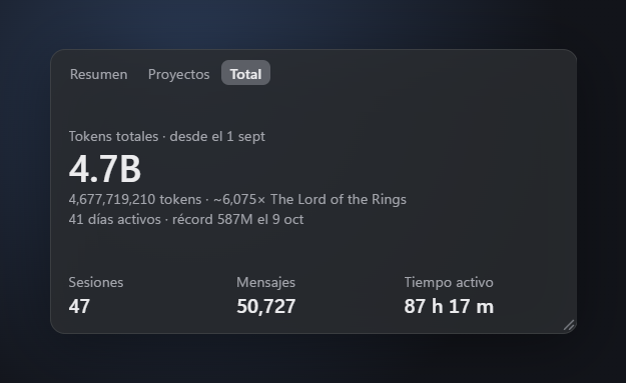

# Claude Stats

*[English](README.md)*

Réplica local del panel de uso que tenía Claude Code en la pantalla de "Nueva sesión" de Claude Desktop (lo quitaron en la versión 2.42304.0), con algunas ideas del plugin `/heatmap` de la comunidad: tiempo activo, rachas y detalle por proyecto. Además trae un widget de escritorio.

> **Proyecto no oficial.** No está afiliado, respaldado ni patrocinado por Anthropic. "Claude" y "Claude Code" son marcas de Anthropic, PBC.

<p align="center">
  
</p>

<p align="center">
  
  
</p>

## Qué muestra
- **Resumen** (igual al panel original): Sesiones, Mensajes, Tokens totales, Días activos, Hora pico y Modelo favorito, más el heatmap celeste de días.
  - Pasa el mouse por un cuadrito: tokens del día, fecha, tiempo activo y proyecto principal.
  - Haz clic en un cuadrito: debajo aparecen los proyectos de ese día con su tiempo y tokens. Clic de nuevo o `Esc` lo cierra.
  - Abajo a la derecha, **Color: tokens · tiempo** cambia qué pinta el azul del heatmap.
- **Modelos**: tokens y respuestas por modelo, con su porcentaje.
- **Proyectos**: tiempo activo total, racha actual, mejor racha, día y hora pico, y la lista de proyectos con su tiempo, porcentaje, tokens y sesiones. Se puede ordenar por tiempo, tokens o sesiones. Clic en un proyecto: mini heatmap de sus últimas 12 semanas.
- **Filtros** en la barra de arriba: rango (Todo / 30d / 7d) y proyecto ("Todos los proyectos" o uno solo). El proyecto elegido y el color del heatmap se recuerdan para la próxima vez.
- **Idioma**: español o inglés. Por defecto sigue el idioma de Windows (español si es `es-*`; si no, inglés). Se cambia con **Español · English** debajo del panel, o con **Idioma** en el menú de la bandeja del widget; el panel y el widget se cambian juntos. También se puede forzar en la dirección: `http://127.0.0.1:4747/?lang=es`.

- **Widget de escritorio**: una cajita semitransparente con tres pestañitas: **Resumen** (heatmap de las últimas ~16 semanas, tokens, racha actual y tiempo activo), **Proyectos** y **Total**, y un selector de período **Hoy · 30d · Todo** (ver más abajo).

## Requisitos
- Windows con Node.js (cualquier versión 18 o superior).
- Para el widget: instalarlo una vez (ver *Widget de escritorio*). Sin widget, el panel se abre en Microsoft Edge (viene con Windows).

## Uso
1. Descarga el proyecto y déjalo en una carpeta fija, por ejemplo `C:\Users\<tu usuario>\claude-code-stats-widget`:
   ```
   git clone https://github.com/RodrigoRivera/claude-code-stats-widget.git
   ```
2. Doble clic en **Abrir Claude Stats.vbs**. Abre el widget; si el widget no está instalado, abre el panel en una ventana propia de Edge, como antes.
3. Para cerrarlo del todo: **Cerrar Claude Stats.bat** (cierra el widget y detiene el servidor).

Se actualiza solo cada 60 segundos.

Otras formas de abrir `Abrir Claude Stats.vbs` (agregando el texto al final del destino de un acceso directo):
- ` /panel`: el panel completo en Edge, sin widget.
- ` /fondo`: solo el servidor, sin abrir ventana.

## Widget de escritorio
### Instalarlo (una vez)
Abre una terminal en la carpeta `widget` y corre:

```
npm install
```

Descarga Electron (unos 110 MB) dentro de `widget\node_modules`. No toca nada fuera de esa carpeta.

### Usarlo
- **Abrir Claude Stats.vbs** lo abre. Si el servidor no está andando, el widget lo levanta solo (no hace falta tener la consola abierta). Volver a abrirlo no crea otro widget, solo muestra el que ya está.
- **Arrastra** el widget para moverlo. Para cambiar el tamaño, arrastra la **esquina de abajo a la derecha** (aparece al pasar el mouse). Más ancho = más semanas; más alto = cuadritos más grandes. Recuerda dónde lo dejaste y de qué tamaño.
- **Clic** (sin arrastrar) abre el **panel completo** en su propia ventana.
- Arriba tiene tres **pestañitas** (se acuerda de la última que usaste):
  - **Resumen**: tokens, racha actual, tiempo activo y el heatmap. Pasa el mouse por un cuadrito para ver los tokens de ese día.
  - **Proyectos**: tus proyectos ordenados por tiempo activo, con su barra, tiempo y tokens. Si no caben, usa la rueda del mouse.
  - **Total**: tokens totales en grande desde tu primer día, con la cifra completa y la comparación con The Lord of the Rings, tus días activos y tu día récord, más sesiones, mensajes y tiempo activo de todo el historial. Si el widget es muy angosto, la cifra completa se esconde y queda la comparación.
- A la derecha de las pestañas está el **período**: **Hoy · 30d · Todo** (también se recuerda).
  - En **Resumen** cambia los tokens y el tiempo activo (por ejemplo "Tokens 7 días" o "Tokens totales") y atenúa en el heatmap los días que quedan fuera. La racha no cambia.
  - En **Proyectos** muestra los proyectos de ese período.
  - En **Total** no aparece, porque esa pestaña siempre es todo el historial.
  - 30d se cuenta hacia atrás desde hoy, igual que en el panel.
- **Clic derecho** en el widget o en el **ícono de la bandeja** (junto al reloj) abre el menú:
  - *Abrir panel completo* y *Mostrar / Ocultar widget* (un clic en el ícono de la bandeja también lo muestra u oculta).
  - *Siempre encima*: el widget queda sobre las demás ventanas.
  - *Iniciar con Windows*: abre el widget al iniciar sesión.
  - *Idioma*: Automático (el de Windows), Español o English.
  - *Actualizar datos* y *Salir*.
- *Salir* cierra el widget y el panel. Si el servidor lo había levantado el widget, también lo detiene; si ya estaba andando de antes, lo deja.
- La posición, el tamaño y *Siempre encima* se guardan en `%USERPROFILE%\.claude\claude-stats\widget.json`. Si lo borras, el widget vuelve abajo a la derecha de la pantalla.
- El widget siempre muestra todos los proyectos (no usa el filtro del panel).

Para probar el modo compacto sin Electron: http://127.0.0.1:4747/?widget=1 (ahí un clic lleva al panel).

## Acceso directo, barra de tareas y arranque con Windows
Doble clic en **Crear acceso directo.vbs**:
- Deja un acceso directo **Claude Stats** con su ícono en el escritorio (abre el widget, o el panel si el widget no está instalado). Para anclarlo: clic derecho sobre él → *Mostrar más opciones* → *Anclar a la barra de tareas*.
- Te pregunta si quieres que **arranque con Windows**. Si dices que sí, al iniciar sesión se levanta solo el servidor (sin abrir ventana). Si lo vuelves a ejecutar y dices que no, se quita.

Si usas el widget, es más simple marcar *Iniciar con Windows* en el menú de la bandeja: abre el widget al iniciar sesión y el widget levanta el servidor. No hace falta tener las dos opciones activadas, pero tampoco molesta.

Conviene anclar ese acceso directo y no la ventana de Edge: la ventana anclada abre Edge directo y, si el servidor no está andando, muestra un error.

Si lo prefieres a mano: `Win + R` → `shell:startup` → pega ahí un acceso directo a `Abrir Claude Stats.vbs` y agrega ` /fondo` al final del destino.

## De dónde salen los datos
- Lee los registros de Claude Code en `%USERPROFILE%\.claude\projects\` (solo fechas, carpeta, modelo y tokens; nunca el texto de los mensajes). Para el saludo lee solo el nombre de tu cuenta (`displayName`) de `%USERPROFILE%\.claude.json`. Nunca lee tus credenciales.
- Guarda su propio historial en `%USERPROFILE%\.claude\claude-stats\days.json`, así los días no desaparecen cuando Claude Code borra registros antiguos.
- Nada sale de tu computador: el servidor solo escucha en `127.0.0.1:4747`.

## Cómo se calcula
- **Tokens totales** suma entrada, salida y caché (lectura y escritura), por eso las cifras son grandes.
- **Tiempo activo**: suma los ratos entre mensajes seguidos de una misma sesión; las pausas de más de 5 minutos no cuentan (la misma regla que el plugin `/heatmap`).
- **Proyecto**: la carpeta donde empezó la sesión. Los nombres que solo cambian en mayúsculas o minúsculas (por ejemplo `miapp` y `MiApp`) se juntan bajo el que tiene más tiempo.
- **Racha**: días seguidos con actividad, terminando hoy o ayer.
- La intensidad del azul se calcula según tus propios días: los días más pesados quedan en el azul más fuerte.

## Opcional
- **Cambiar el nombre del saludo o el puerto:** variables de entorno `CLAUDE_STATS_NAME` y `CLAUDE_STATS_PORT`. Por defecto el saludo usa el nombre de tu cuenta de Claude; si no lo encuentra, dice solo "¿Qué sigue?".

## Licencia
[MIT](LICENSE).
