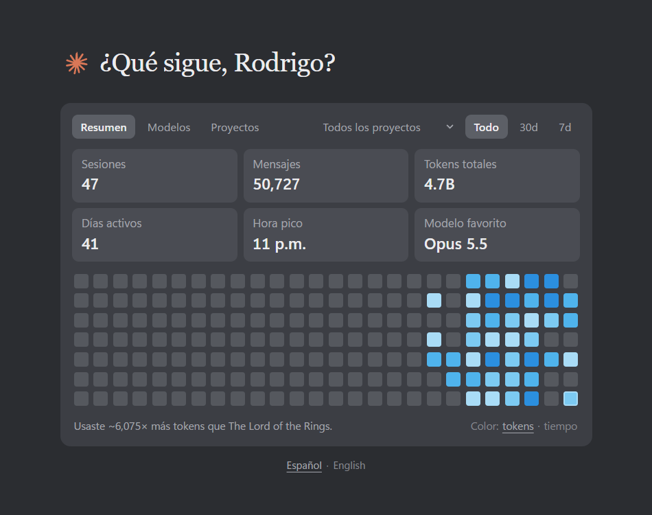
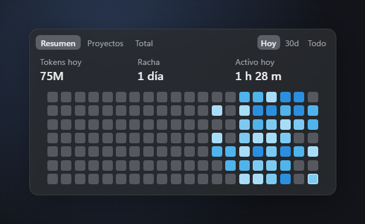

# Claude Stats

*[English](README.md)*

Réplica local del panel de uso que tenía Claude Code en la pantalla de "Nueva sesión" de Claude Desktop (lo quitaron en la versión 2.42304.0), con algunas ideas del plugin `/heatmap` de la comunidad: tiempo activo, rachas y detalle por proyecto. Además trae un widget de escritorio.

> **Proyecto no oficial.** No está afiliado, respaldado ni patrocinado por Anthropic. "Claude" y "Claude Code" son marcas de Anthropic, PBC.

<p align="center">
  
</p>

<p align="center">
  
  
</p>

## Qué muestra
- **Resumen** (igual al panel original): Sesiones, Mensajes, Tokens totales, Días activos, Hora pico y Modelo favorito, más el heatmap celeste de días.
  - Pasa el mouse por un cuadrito: tokens del día, fecha, tiempo activo y proyecto principal.
  - Haz clic en un cuadrito: debajo aparecen los proyectos de ese día con su tiempo y tokens. Clic de nuevo o `Esc` lo cierra.
  - Abajo a la derecha, **Color: tokens · tiempo** cambia qué pinta el azul del heatmap.
- **Modelos**: tokens y respuestas por modelo, con su porcentaje.
- **Proyectos**: tiempo activo total, racha actual, mejor racha, día y hora pico, y la lista de proyectos con su tiempo, porcentaje, tokens y sesiones. Se puede ordenar por tiempo, tokens o sesiones. Clic en un proyecto: mini heatmap de sus últimas 12 semanas.
- **Filtros** en la barra de arriba: rango (Todo / 30d / 7d) y proyecto ("Todos los proyectos" o uno solo). El proyecto elegido y el color del heatmap se recuerdan para la próxima vez.
- **Varios PCs**: si usas Claude Code en más de un computador, con una carpeta compartida de OneDrive suma el uso de todos y muestra cuánto aportó cada uno (ver *Varios PCs* más abajo).
- **Idioma**: español o inglés. Por defecto sigue el idioma de Windows (español si es `es-*`; si no, inglés). Se cambia con **Español · English** debajo del panel, o con **Idioma** en el menú de la bandeja del widget; el panel y el widget se cambian juntos. También se puede forzar en la dirección: `http://127.0.0.1:4747/?lang=es`.

- **Widget de escritorio**: una cajita semitransparente con tres pestañitas: **Resumen** (heatmap de las últimas ~16 semanas, tokens, racha actual y tiempo activo), **Proyectos** y **Total**, y un selector de período **Hoy · 30d · Todo** (ver más abajo).

## Instalación (5 minutos)
Necesitas **Windows 10/11** y haber usado **Claude Code** al menos una vez en ese PC (lee sus registros).

### 1. Instala Node.js
Descarga la versión **LTS** desde <https://nodejs.org> e instálala con las opciones por defecto. Si ya lo tienes, sáltate este paso (`node -v` en una terminal muestra la versión; sirve la 18 o superior).

### 2. Descarga Claude Stats
- En el [último release](https://github.com/RodrigoRivera/claude-code-stats-widget/releases/latest), descarga **Source code (zip)**.
- Clic derecho en el ZIP → **Extraer todo…** y elige una carpeta que vayas a conservar, por ejemplo `C:\Users\<tu usuario>\claude-code-stats-widget`. El ícono del escritorio apunta ahí, así que no lo dejes en *Descargas* si sueles limpiarla.

¿Prefieres git? `git clone https://github.com/RodrigoRivera/claude-code-stats-widget.git`

### 3. Doble clic en `Instalar Claude Stats.bat`
Hace todo en más o menos un minuto:
1. Instala el widget de escritorio (descarga Electron, unos 110 MB, dentro de la carpeta `widget`).
2. Deja el ícono **Claude Stats** en el escritorio.
3. Abre el widget abajo a la derecha de la pantalla.

Si Windows muestra *"Windows protegió su PC"*, haz clic en **Más información** → **Ejecutar de todas formas** (aparece con archivos descargados de internet).

### 4. Déjalo a tu gusto
- **Que arranque con Windows:** clic derecho en el widget (o en el ícono de Claude Stats en la bandeja, junto al reloj) → **Iniciar con Windows**.
- **Anclarlo a la barra de tareas:** clic derecho en el ícono del escritorio → *Mostrar más opciones* → *Anclar a la barra de tareas*.
- **Moverlo y cambiar el tamaño:** arrastra el widget; arrastra su esquina de abajo a la derecha para agrandarlo. Recuerda dónde lo dejas.
- **Panel completo:** haz clic en el widget.

## Uso diario
- Ábrelo con el ícono **Claude Stats** del escritorio (o con `Abrir Claude Stats.vbs`). Levanta su servidor local solo, con el Node.js que trae Electron. Se actualiza cada 60 segundos.
- **`Cerrar Claude Stats.bat`** cierra el widget y detiene el servidor.
- **Actualizar:** descarga el release nuevo, extráelo encima de la misma carpeta y vuelve a ejecutar `Instalar Claude Stats.bat`. Tu historial se mantiene (está en `%USERPROFILE%\.claude\claude-stats`, no en esa carpeta).

### Problemas comunes
| Lo que ves | Solución |
|---|---|
| Se abre el panel en Edge en vez del widget | El widget no está instalado: vuelve a ejecutar `Instalar Claude Stats.bat` (necesita internet). |
| Windows bloquea un `.vbs` o `.bat` | Clic derecho en el archivo → *Propiedades* → marca **Desbloquear** → Aceptar. |
| El widget muestra "—" o no tiene cuadritos | Claude Code todavía no se ha usado en este PC (`%USERPROFILE%\.claude\projects` está vacía). Cada computador cuenta su propio uso. |
| "No encontré Node.js" | Instala Node.js (paso 1) y vuelve a ejecutar el instalador. |

## Widget de escritorio
### Usarlo
- El ícono del escritorio (o **Abrir Claude Stats.vbs**) lo abre. Si el servidor no está andando, el widget lo levanta solo (no hace falta tener la consola abierta). Volver a abrirlo no crea otro widget, solo muestra el que ya está.
- **Arrastra** el widget para moverlo. Para cambiar el tamaño, arrastra la **esquina de abajo a la derecha** (aparece al pasar el mouse). Más ancho = más semanas; más alto = cuadritos más grandes. Recuerda dónde lo dejaste y de qué tamaño.
- **Clic** (sin arrastrar) abre el **panel completo** en su propia ventana.
- Arriba tiene tres **pestañitas** (se acuerda de la última que usaste):
  - **Resumen**: tokens, racha actual, tiempo activo y el heatmap. Pasa el mouse por un cuadrito para ver los tokens de ese día.
  - **Proyectos**: tus proyectos ordenados por tiempo activo, con su barra, tiempo y tokens. Si no caben, usa la rueda del mouse.
  - **Total**: tokens totales en grande desde tu primer día, con la cifra completa y la comparación con The Lord of the Rings, tus días activos y tu día récord, más sesiones, mensajes y tiempo activo de todo el historial. Si el widget es muy angosto, la cifra completa se esconde y queda la comparación.
- A la derecha de las pestañas está el **período**: **Hoy · 30d · Todo** (también se recuerda).
  - En **Resumen** cambia los tokens y el tiempo activo (por ejemplo "Tokens 30 días" o "Tokens totales") y atenúa en el heatmap los días que quedan fuera. La racha no cambia.
  - En **Proyectos** muestra los proyectos de ese período.
  - En **Total** no aparece, porque esa pestaña siempre es todo el historial.
  - 30d se cuenta hacia atrás desde hoy, igual que en el panel.
- **Clic derecho** en el widget o en el **ícono de la bandeja** (junto al reloj) abre el menú:
  - *Abrir panel completo* y *Mostrar / Ocultar widget* (un clic en el ícono de la bandeja también lo muestra u oculta).
  - *Siempre encima*: el widget queda sobre las demás ventanas.
  - *Iniciar con Windows*: abre el widget al iniciar sesión.
  - *Idioma*: Automático (el de Windows), Español o English.
  - *Actualizar datos* y *Salir*.
- *Salir* cierra el widget y el panel. Si el servidor lo había levantado el widget, también lo detiene; si ya estaba andando de antes, lo deja.
- La posición, el tamaño y *Siempre encima* se guardan en `%USERPROFILE%\.claude\claude-stats\widget.json`. Si lo borras, el widget vuelve abajo a la derecha de la pantalla.
- El widget siempre muestra todos los proyectos (no usa el filtro del panel).

Para probar el modo compacto sin Electron: http://127.0.0.1:4747/?widget=1 (ahí un clic lleva al panel).

## Varios PCs (sincronizar con OneDrive)
Si usas Claude Code en más de un computador, Claude Stats puede sumar el uso de todos. Usa una carpeta compartida de OneDrive: cada PC deja ahí un resumen de su historial y lee el de los demás.

Está **apagado** hasta que exista la carpeta `OneDrive\claude-stats`. Sin ella, todo funciona igual que siempre, solo con los datos de ese PC.

### En el primer PC
1. Revisa que OneDrive tenga tu cuenta iniciada.
2. En la carpeta de Claude Stats, abre PowerShell y corre:
   ```powershell
   powershell -ExecutionPolicy Bypass -File instalar-sync.ps1
   ```
   Crea la carpeta, registra una tarea que actualiza el resumen de este PC al iniciar sesión y cada hora (sin abrir ventanas) y hace la primera sincronización.

### En el segundo PC
1. Instala Claude Stats como siempre (pasos 1 a 3 de la *Instalación*).
2. Inicia sesión en OneDrive con **la misma cuenta** y espera a que aparezca `OneDrive\claude-stats` con el archivo del primer PC.
3. *(Opcional)* Ponle un nombre a cada PC: abre `%USERPROFILE%\.claude\claude-stats\config.json` y cambia `"deviceName"` (por ejemplo `"Notebook"`). Renombrar no duplica nada: el archivo viejo se reemplaza.
4. Corre `instalar-sync.ps1` también ahí, igual que en el primero.
5. Abre el panel completo: junto al filtro de proyectos aparece el selector **Todos los PCs / <PC>**, y al pasar el mouse por un día ves cuánto aportó cada PC.

### Bueno saber
- Cada PC guarda su historial completo en `<carpeta>\<nombre del PC>.json`: fechas, carpetas de proyecto, modelos y conteos; nunca el texto de los mensajes. OneDrive lo sube a tu cuenta.
- Los totales se suman sin repetir sesiones. Las copias de conflicto de OneDrive se ignoran.
- Con el widget abierto, el resumen también se actualiza cada minuto; la tarea programada cubre los ratos en que está cerrado.
- Otra carpeta (Google Drive, Dropbox, una carpeta de red): cambia `"syncDir"` en `config.json`.
- Quitar la tarea: `instalar-sync.ps1 -Quitar`. Dejar de sincronizar: borra la carpeta o pon `"syncDir": ""`.
- El widget siempre muestra todos los PCs; el selector está en el panel completo.

## Avanzado
- **Solo el panel, sin widget:** corre `node server.js` y abre <http://127.0.0.1:4747> (`--no-open` lo levanta sin abrir ventana). El servidor funciona en cualquier sistema con Node.js.
- **El widget a mano:** `cd widget`, `npm install`, `npm start`.
- **El acceso directo a mano:** `Crear acceso directo.vbs` crea el ícono del escritorio y pregunta si quieres que el servidor solo (sin ventana) arranque con Windows; si lo vuelves a ejecutar y dices que no, se quita. O bien: `Win + R` → `shell:startup` → un acceso directo a `Abrir Claude Stats.vbs` con ` /fondo` al final del destino.
- **Opciones del lanzador:** `Abrir Claude Stats.vbs /panel` abre el panel en Edge sin widget; `/fondo` arranca solo el servidor; `/sync` actualiza el resumen para varios PCs y termina, sin ventanas.
- **`node server.js --sync`**: actualiza el historial y el resumen de este PC en la carpeta compartida y termina (es lo que corre la tarea programada).
- Conviene anclar el ícono del escritorio y no la ventana de Edge del panel: la ventana anclada abre Edge directo y, si el servidor no está andando, muestra un error.

## De dónde salen los datos
- Lee los registros de Claude Code en `%USERPROFILE%\.claude\projects\` (solo fechas, carpeta, modelo y tokens; nunca el texto de los mensajes). Para el saludo lee solo el nombre de tu cuenta (`displayName`) de `%USERPROFILE%\.claude.json`. Nunca lee tus credenciales.
- Guarda su propio historial en `%USERPROFILE%\.claude\claude-stats\days.json`, así los días no desaparecen cuando Claude Code borra registros antiguos.
- Ajustes para varios PCs: `%USERPROFILE%\.claude\claude-stats\config.json` (`syncDir`, `deviceName` y un `deviceId` interno).
- Nada sale de tu computador: el servidor solo escucha en `127.0.0.1:4747`. La excepción es si activas *Varios PCs*: un resumen de tu historial (sin el texto de los mensajes) va a la carpeta que elegiste, y tu servicio en la nube (OneDrive, etc.) lo sube a tu cuenta.

## Cómo se calcula
- **Tokens totales** suma entrada, salida y caché (lectura y escritura), por eso las cifras son grandes.
- **Tiempo activo**: suma los ratos entre mensajes seguidos de una misma sesión; las pausas de más de 5 minutos no cuentan (la misma regla que el plugin `/heatmap`).
- **Proyecto**: la carpeta donde empezó la sesión. Los nombres que solo cambian en mayúsculas o minúsculas (por ejemplo `miapp` y `MiApp`) se juntan bajo el que tiene más tiempo.
- **Racha**: días seguidos con actividad, terminando hoy o ayer.
- La intensidad del azul se calcula según tus propios días: los días más pesados quedan en el azul más fuerte.

## Opcional
- **Cambiar el nombre del saludo o el puerto:** variables de entorno `CLAUDE_STATS_NAME` y `CLAUDE_STATS_PORT`. Por defecto el saludo usa el nombre de tu cuenta de Claude; si no lo encuentra, dice solo "¿Qué sigue?".

## Contribuir
Los reportes de errores, ideas y pull requests son bienvenidos, en español o en inglés. Para empezar, mira [CONTRIBUTING.md](.github/CONTRIBUTING.md) (en inglés), el [código de conducta](.github/CODE_OF_CONDUCT.md) y [SECURITY.md](.github/SECURITY.md) para reportar un problema de seguridad en privado. Los cambios de cada versión están en el [CHANGELOG](CHANGELOG.md).

## Licencia
[MIT](LICENSE).
