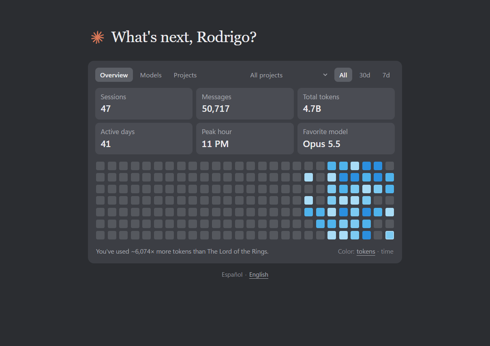
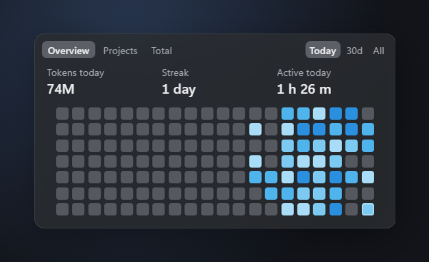
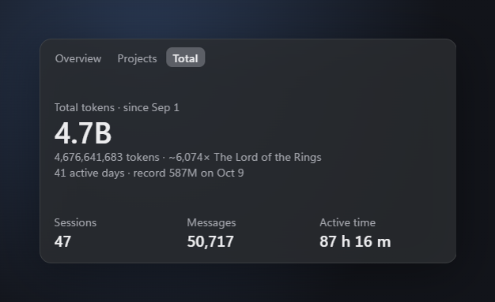

# Claude Stats

*[Español](LEEME.md)*

**The usage panel that Claude Desktop removed, back on your desktop — and it never forgets your old days.**

Claude Desktop used to show a usage card on the Code tab's new-session screen: sessions, messages, tokens, active days, peak hour, favorite model and a daily heatmap. It disappeared in Desktop v2.42304.0 ([anthropics/claude-code#102264](https://github.com/anthropics/claude-code/issues/102264)). Claude Stats brings it back as its own window and a small desktop widget, reading the same local Claude Code logs, and adds what the original never had: active time, streaks, per-project breakdowns and a history that survives log cleanup.

> **Unofficial project.** Not affiliated with, endorsed or sponsored by Anthropic. "Claude" and "Claude Code" are trademarks of Anthropic, PBC.

<p align="center">
  
</p>

<p align="center">
  
  
</p>

## Why another usage tool?
Most Claude usage tools track **plan limits** (the 5-hour and weekly quotas) and read your login token to do it. Claude Stats is about **your history**, and it never touches your credentials:

- **Looks like the original panel.** Same cards, same blue heatmap, same All / 30d / 7d filters.
- **Keeps its own history.** Claude Code deletes transcripts after 30 days by default. Claude Stats saves a daily summary, so old days stay on your heatmap.
- **Active time**, not just tokens: the time between consecutive messages of a session, ignoring breaks longer than 5 minutes.
- **Projects:** time, tokens and sessions per project, a mini heatmap for each, and a filter that recalculates every tab for one project.
- **Desktop widget** with tabs (Overview / Projects / Total), a Today / 30d / All period selector, tray icon, *Always on top* and *Start with Windows*.
- **Several PCs, one view.** Use Claude Code on more than one computer? With a shared OneDrive folder, it adds them up and shows how much each PC contributed.
- **English and Spanish.** It follows your system language; switch it under the panel or from the tray menu.
- **Private and light.** The server is plain Node.js with **zero dependencies**, listens only on `127.0.0.1`, makes no network requests, and only reads dates, folders, models and token counts — never your messages or credentials.

## What it shows
- **Overview**: sessions, messages, total tokens, active days, peak hour, favorite model and the daily heatmap, with the All / 30d / 7d filters. Hover a square for that day's tokens, active time and main project; click it to see that day's projects. Color the heatmap by tokens or by active time.
- **Models**: tokens and responses per model.
- **Projects**: total active time, current and best streak, peak day and hour, and every project with its time, share, tokens and sessions. Sort by time, tokens or sessions.
- **Widget**: a semi-transparent box with three tabs — tokens, streak, active time and a heatmap; your projects; and all-time totals (since your first day, with the Lord of the Rings comparison, active days and your record day). A period selector (Today / 30d / All) switches tokens, active time and projects between today, the last 30 days and all time, and dims the heatmap days outside it. Drag to move, drag the bottom-right corner to resize, click to open the full panel.

**Language:** English or Spanish. By default it follows your system language (Spanish for `es-*`, English otherwise). Change it with **Español · English** under the panel, or with **Language** in the widget's tray menu; the panel and the widget stay in sync. You can also force it in the address: `http://127.0.0.1:4747/?lang=en`.

## Install (5 minutes)
You need **Windows 10/11** and **Claude Code** used at least once on that PC (it reads its logs).

### 1. Install Node.js
Download the **LTS** version from <https://nodejs.org> and install it with the default options. Skip this if you already have it (`node -v` in a terminal shows the version; 18 or newer is fine).

### 2. Download Claude Stats
- On the [latest release](https://github.com/RodrigoRivera/claude-code-stats-widget/releases/latest), download **Source code (zip)**.
- Right-click the ZIP → **Extract All…** and pick a folder you'll keep, for example `C:\Users\<you>\claude-code-stats-widget`. The desktop icon will point there, so don't leave it in *Downloads* if you clean that folder.

Using git instead? `git clone https://github.com/RodrigoRivera/claude-code-stats-widget.git`

### 3. Double-click `Instalar Claude Stats.bat`
It does everything in about a minute:
1. Installs the desktop widget (downloads Electron, ~110 MB, into the `widget` folder).
2. Puts a **Claude Stats** icon on your desktop.
3. Opens the widget at the bottom right of your screen.

If Windows shows *"Windows protected your PC"*, click **More info** → **Run anyway** (it appears for files downloaded from the internet).

### 4. Make it yours
- **Start with Windows:** right-click the widget (or the Claude Stats icon in the tray, next to the clock) → **Start with Windows**.
- **Pin it to the taskbar:** right-click the desktop icon → *Show more options* → *Pin to taskbar*.
- **Move and resize:** drag the widget; drag its bottom-right corner to resize. It remembers where you leave it.
- **Full panel:** click the widget.

## Everyday use
- Open it with the **Claude Stats** desktop icon (or `Abrir Claude Stats.vbs`). It starts its local server by itself, using the Node.js that ships with Electron. Data refreshes every 60 seconds.
- Right-click the widget or the tray icon for: open full panel, show/hide widget, **Always on top**, **Start with Windows**, **Language** (Automatic / Español / English), refresh, quit.
- **`Cerrar Claude Stats.bat`** closes the widget and stops the server.
- **Updating:** download the new release, extract it over the same folder, and run `Instalar Claude Stats.bat` again. Your history is kept (it lives in `%USERPROFILE%\.claude\claude-stats`, not in that folder).

### Troubleshooting
| What you see | Fix |
|---|---|
| The panel opens in Edge instead of the widget | The widget isn't installed: run `Instalar Claude Stats.bat` again (it needs internet). |
| Windows blocks a `.vbs` or `.bat` file | Right-click it → *Properties* → tick **Unblock** → OK. |
| The widget shows "—" or no squares | Claude Code hasn't been used on this PC yet (`%USERPROFILE%\.claude\projects` is empty). Each computer counts its own usage. |
| "Node.js was not found" | Install Node.js (step 1) and run the installer again. |

## Several PCs (sync with OneDrive)
If you use Claude Code on more than one computer, Claude Stats can add them all up. It uses a shared OneDrive folder: each PC leaves a summary of its history there and reads the others'.

It's **off** until the folder `OneDrive\claude-stats` exists. Without it, everything works as before, with that PC's data only.

### On the first PC
1. Make sure OneDrive is signed in with your account.
2. In the Claude Stats folder, open PowerShell and run:
   ```powershell
   powershell -ExecutionPolicy Bypass -File instalar-sync.ps1
   ```
   It creates the folder, registers a task that updates this PC's summary when you sign in and every hour (no windows), and does the first sync.

### On the second PC
1. Install Claude Stats as usual (steps 1–3 of *Install*).
2. Sign in to OneDrive with **the same account**, and wait until `OneDrive\claude-stats` shows up with the first PC's file.
3. *(Optional)* Give each PC a friendly name: open `%USERPROFILE%\.claude\claude-stats\config.json` and change `"deviceName"` (for example `"Notebook"`). Renaming is safe: the old file is replaced, not counted twice.
4. Run `instalar-sync.ps1` there too, as on the first PC.
5. Open the full panel: a **All PCs / <PC>** selector appears next to the project filter, and hovering a day shows how much each PC contributed.

### Good to know
- Each PC writes its full history to `<folder>\<PC name>.json`: dates, project folders, models and counts, never the text of your messages. OneDrive uploads it to your account.
- Totals are added up without repeating sessions. OneDrive conflict copies are ignored.
- While the widget is open, the summary is also refreshed every minute; the scheduled task covers the times it's closed.
- Another folder (Google Drive, Dropbox, a network share): set `"syncDir"` in `config.json`.
- Remove the task: `instalar-sync.ps1 -Quitar`. Stop syncing: delete the folder or set `"syncDir": ""`.
- The widget always shows all PCs; the selector is in the full panel.

## Advanced
- **Panel only, without the widget:** run `node server.js` and open <http://127.0.0.1:4747> (`--no-open` starts it without a window). The server runs anywhere Node.js runs.
- **Widget by hand:** `cd widget`, `npm install`, `npm start`.
- **Shortcut by hand:** `Crear acceso directo.vbs` creates the desktop icon and asks whether the server alone should start with Windows; run it again and answer *No* to undo. Or `Win + R` → `shell:startup` → a shortcut to `Abrir Claude Stats.vbs` with ` /fondo` at the end of its target.
- **Launcher options:** `Abrir Claude Stats.vbs /panel` opens the panel in Edge without the widget; `/fondo` starts only the server; `/sync` updates the multi-PC summary and exits, with no windows.
- Pin the desktop icon, not the panel's Edge window: a pinned Edge window opens Edge directly and shows an error if the server isn't running.

## Where the data comes from
- Claude Code's local logs: `%USERPROFILE%\.claude\projects\**\*.jsonl`.
- Its own history: `%USERPROFILE%\.claude\claude-stats\days.json` (one summary per day).
- Widget position and settings: `%USERPROFILE%\.claude\claude-stats\widget.json`.
- Sync settings: `%USERPROFILE%\.claude\claude-stats\config.json` (`syncDir`, `deviceName` and an internal `deviceId`).
- For the greeting it reads only your account's `displayName` from `%USERPROFILE%\.claude.json`.

Nothing leaves your computer, unless you turn on [multi-PC sync](#several-pcs-sync-with-onedrive): then a summary of your history (no message text) goes to the folder you chose, and your cloud service (OneDrive, etc.) uploads it to your account.

## How it counts
- **Message:** each `user` or `assistant` log line with a unique `uuid` (resumed sessions copy lines, so they are de-duplicated).
- **Tokens:** input + output + cache creation + cache read, de-duplicating responses by `message.id` + `requestId`. That's why totals are large.
- **Active time:** the sum of gaps between consecutive messages of the same session, ignoring gaps longer than 5 minutes.
- **Project:** the last folder of the session's first working directory. Names that differ only in case are merged.
- **Streak:** consecutive days with activity, ending today or yesterday.
- Dates and hours use your computer's local time.

## Options
| Environment variable | What it does |
|---|---|
| `CLAUDE_STATS_NAME` | Name in the greeting (defaults to your Claude account name) |
| `CLAUDE_STATS_PORT` | Server port (default `4747`) |
| `CLAUDE_CONFIG_DIR` | Claude Code config folder, if you moved it |
| `CLAUDE_STATS_SYNC_DIR` | Shared folder for multi-PC sync (overrides `syncDir` in `config.json`) |
| `CLAUDE_STATS_DEVICE` | This PC's name for sync (overrides `deviceName`) |

`node server.js --no-open` starts the server without opening a window. `node server.js --sync` updates the history and this PC's summary in the shared folder, then exits (that's what the scheduled task runs, through `Abrir Claude Stats.vbs /sync`). `GET /api/stats` returns the aggregated data as JSON (`?refresh=1` skips the 20-second cache).

## Project layout
- `server.js` — reads the logs, keeps the history and serves the page and the API. No dependencies.
- `index.html` — the whole interface (HTML + CSS + JS, no build step). `/?widget=1` is the compact widget view.
- `widget/` — the Electron desktop widget (`main.js`, `preload.js`). The only folder with an npm dependency (`electron`, pinned).
- `*.vbs` / `*.bat` — Windows launchers and the installer.
- `instalar-sync.ps1` — registers the multi-PC sync task in Windows Task Scheduler.

## Contributing
Bug reports, ideas and pull requests are welcome, in English or Spanish. See [CONTRIBUTING.md](.github/CONTRIBUTING.md) to get started, the [Code of Conduct](.github/CODE_OF_CONDUCT.md), and [SECURITY.md](.github/SECURITY.md) to report a security problem privately. Changes are listed in the [CHANGELOG](CHANGELOG.md).

## License
[MIT](LICENSE).
